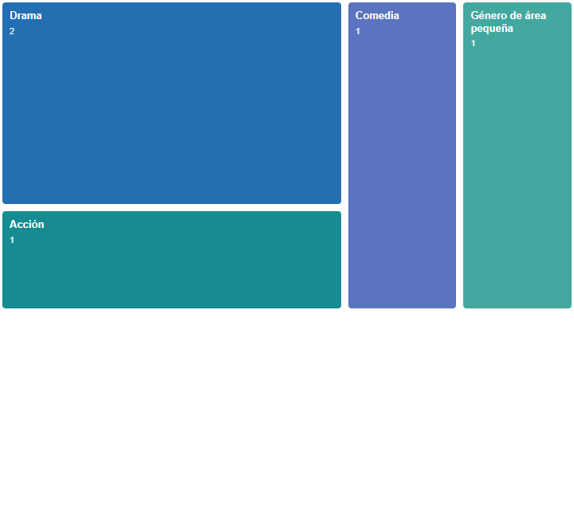
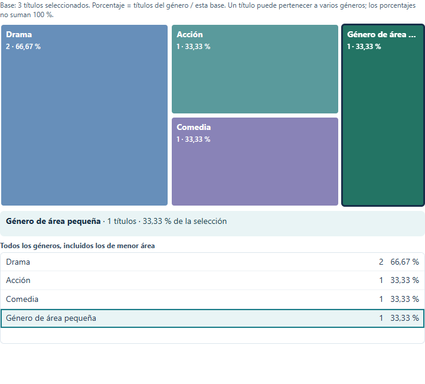
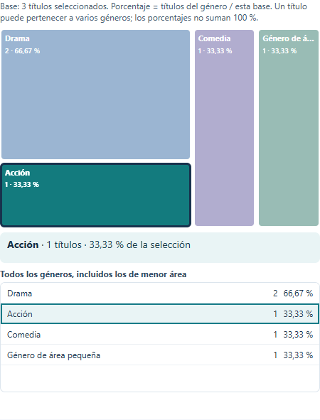
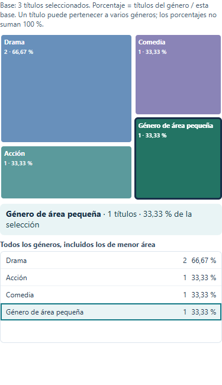
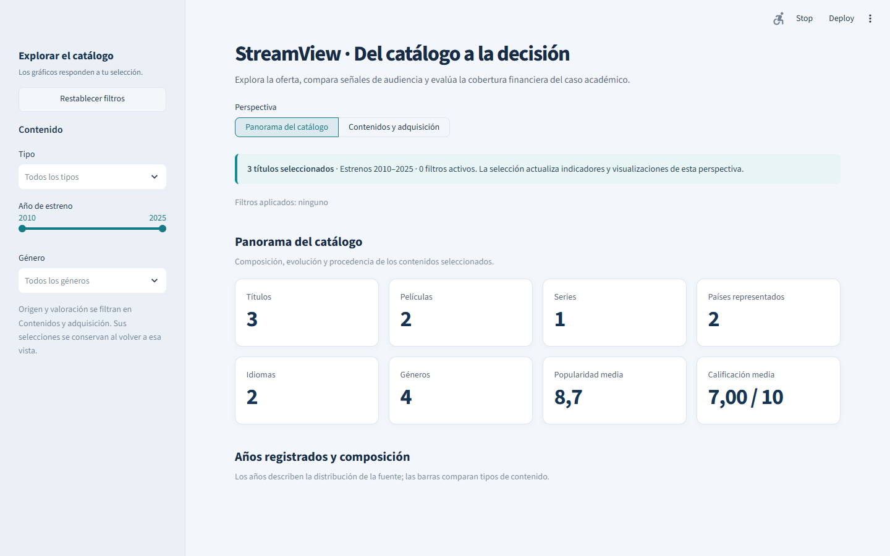
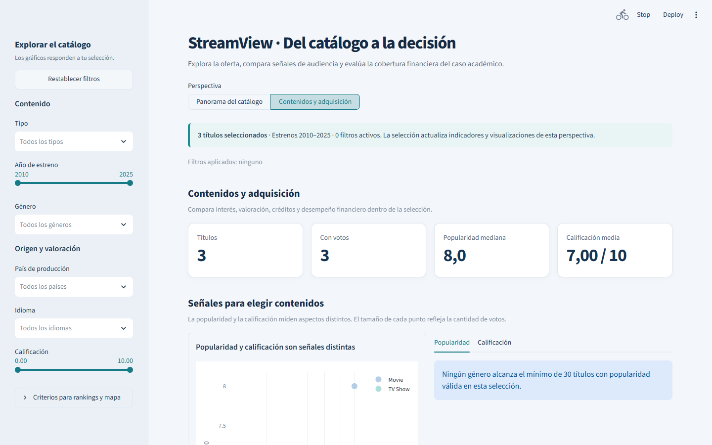
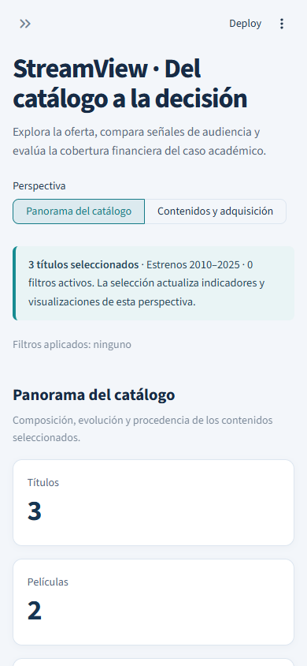

# Evaluación de usabilidad y decisiones de diseño

**Alcance:** Streamlit, perspectivas Panorama del catálogo y Contenidos y adquisición, y treemap D3. Revisión realizada el 16 de octubre de 2026.

| Problema observado antes | Cambio funcional y motivo | Resultado comprobado |
|---|---|---|
| El resumen indicaba solo la cantidad de filtros activos. Era difícil recordar un cruce de tipo, género, país o calificación. | Se muestra cada filtro aplicado junto al total seleccionado. El panel lateral mantiene un único control de restablecimiento durante la exploración normal. | La prueba cruza tipo, género y país en adquisición y verifica el detalle y el total. |
| Una combinación sin títulos detenía el dashboard con un aviso sin acción inmediata. | El estado vacío explica cómo ampliar la selección y ofrece restablecimiento en la vista principal. | La prueba combina Película con Comedia sin coincidencias y restablece los tres títulos de muestra. |
| Los gráficos con umbrales podían quedar vacíos sin explicar por qué. | Se muestran mensajes específicos para popularidad, calificación por género, ranking de títulos y mapa por país. | La vista de adquisición con muestra pequeña explica el mínimo de 30 títulos por género. |
| El treemap mostraba solo cantidades; las categorías pequeñas perdían etiqueta, y el porcentaje no tenía base declarada. | Cada bloque y fila informa cantidad y porcentaje sobre **títulos únicos seleccionados**. Una lista accesible conserva todos los géneros; clic y teclado resaltan el elegido. Se evita superponer etiquetas en bloques pequeños. | Con tres títulos y cinco asociaciones, se ven Drama 2/3 = 66,67 % y tres géneros con 1/3 = 33,33 % cada uno. La suma puede superar 100 %. |
| En un ancho móvil la barra lateral abierta cubría el dashboard. | Streamlit decide el estado inicial de la barra según la pantalla. | Captura a 390 px con navegación y tarjetas visibles. |

## Criterios de diseño

- El área del treemap sigue representando el recuento de títulos asociados a cada género; no cambia el cálculo en `src/`.
- El denominador de cada porcentaje es `len(selected)`, el número de títulos únicos después de aplicar filtros. Un título puede figurar en varios géneros, por lo que los porcentajes no son partes mutuamente excluyentes.
- La lista dentro del treemap da acceso a categorías cuya área es demasiado pequeña para rotularse. Las etiquetas dentro de bloques se muestran solo cuando hay espacio; las descripciones completas siguen disponibles al pasar el cursor, enfocar con teclado o seleccionar una fila.
- Los filtros de origen y valoración se conservan al cambiar de perspectiva y se aplican al volver a adquisición. Una nota en Panorama explica este comportamiento.
- Los avisos por umbral conservan los valores existentes: 30 títulos con popularidad, 100 títulos valorados por género y los umbrales elegidos para rankings y países.

## Validación y alcance de la evidencia

Los CSV originales no están versionados. Las pruebas nuevas usan tres títulos sintéticos en memoria y las capturas corresponden a esa muestra, por lo que no representan las cifras oficiales. Después de recibir los CSV oficiales, se copiaron sin modificar los archivos de Descargas y se verificó que cada copia tuviera el mismo SHA-256 que su fuente.

- `uv run --locked python -m unittest tests.test_dashboard_ux -v`: dos escenarios correctos (panorama con estado vacío y reinicio; adquisición con filtros cruzados y base del treemap).
- `uv run --locked python -m unittest tests.test_dashboard_ux tests.test_business_rules tests.test_financial_rules tests.test_delivery_tools -v`: 12 pruebas correctas con datos en memoria.
- Se fusionó temporalmente la rama con el `main` que ya incluye las mejoras analíticas del PR #7. El merge automático no produjo conflictos. Con los CSV oficiales en ese árbol combinado, `python -m unittest discover -s tests -v` terminó con **23 pruebas correctas**. No se modificaron ni versionaron los CSV.
- `uv run --locked python -m compileall -q dashboard/app.py` y `git diff --check`: sin errores.
- Chrome con Playwright: panorama y adquisición a 1440 × 900, treemap a 720 px y 375 px, dashboard a 390 × 844. Se verificaron renderizado, selección de género, ausencia de desbordamiento horizontal en el treemap y ausencia de errores JavaScript.

## Capturas

Los archivos en [evidence/dashboard-ux](evidence/dashboard-ux) muestran el estado anterior, el treemap nuevo, una selección y ambas perspectivas. Todos usan datos sintéticos.

